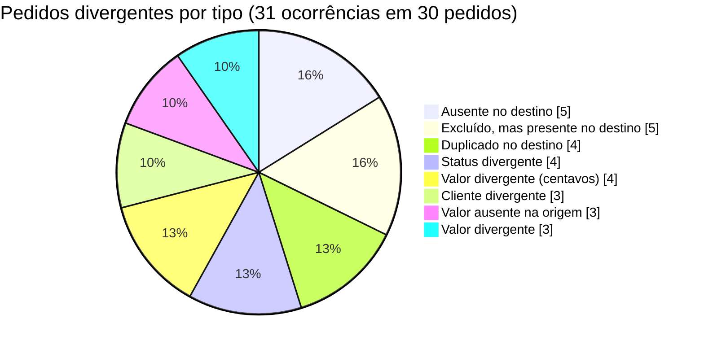
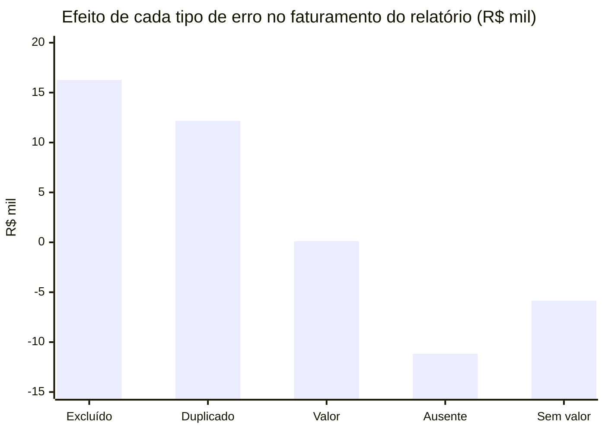
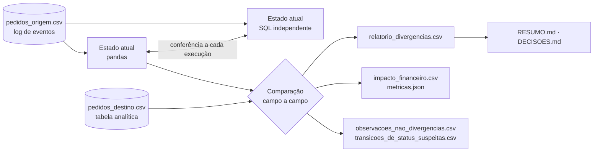

<div align="center">

# Reconciliação de Pedidos

**Case técnico de Engenharia de Dados — AV DATA**


Reconstrói o estado atual de cada pedido a partir do **log de eventos** da origem, compara com a **tabela analítica**
de destino e gera o relatório de divergências, com severidade, confiança e causa provável.

[Resumo para o comercial](RESUMO.md) · [Decisões e premissas](DECISOES.md) · [Enunciado](docs/CASE_Engenharia_de_Dados.md)

</div>

---

## Resultado em uma olhada

| Indicador | Valor |
|---|---:|
| Pedidos distintos no log de eventos | **150** |
| Pedidos existentes na origem (não excluídos) | 133 |
| Pedidos excluídos na origem | 17 |
| Linhas no destino | 137 |
| **Pedidos divergentes** | **30 (20%)** |
| Linhas no relatório (o pedido 10050 tem 2 problemas) | 31 |
| Faturamento real | R$ 296.688,91 |
| Faturamento no relatório (destino) | R$ 308.232,91 |
| **Diferença** | **+ R$ 11.544,00 (3,9%)** |
| Diferença desconsiderando cancelados | + R$ 1.650,99 |
| Incerteza por empates de timestamp | até R$ 1.063,73 |
| Casos que parecem erro, mas não são | 19 |

> O total de **R$ 11,5 mil** parece pequeno porque erros para cima e para baixo se anulam em parte.
> Somados em valor absoluto, os erros do relatório chegam a cerca de **R$ 45,6 mil**.

---

## Divergências por tipo



| Tipo | Pedidos | Impacto no faturamento do relatório |
|---|---:|---:|
| `EXCLUIDO_PRESENTE_NO_DESTINO` | 5 | + R$ 16.270,76 |
| `DUPLICADO_NO_DESTINO` | 4 | + R$ 12.166,63 |
| `AUSENTE_NO_DESTINO` | 5 | − R$ 11.173,64 |
| 0`VALOR_AUSENTE_NA_ORIGEM` | 3 | − R$ 5.836,01 (estimado) |
| `VALOR_DIVERGENTE` | 3 | + R$ 116,28 |
| `VALOR_DIVERGENTE_CENTAVOS` | 4 | − R$ 0,02 |
| `STATUS_DIVERGENTE` | 4 | sem efeito no total |
| `CLIENTE_DIVERGENTE` | 3 | sem efeito no total |
| | | **Soma: + R$ 11.544,00**|

## Impacto financeiro por tipo (R$)



> **Prioridade 1:** pedidos excluídos que continuam no relatório (maior valor; uma única causa — as exclusões não são aplicadas).
> **Prioridade 2:** linhas duplicadas (correção simples: uma linha por pedido).

## Observações que *não* são divergência

Casos que parecem problema, mas estão corretos. Ficam fora do relatório para não acusar erro inexistente
(detalhes em [`observacoes_nao_divergencias.csv`](observacoes_nao_divergencias.csv)).

| Observação | Qtd |
|---|---:|
| `STATUS_SAIU_DE_ESTADO_FINAL` (informativo) | 56 |
| `EVENTO_DUPLICADO_NO_LOG` | 5 |
| `CLIENTE_ALTERADO_NO_LOG` | 4 |
| `SEM_EVENTO_DE_CRIACAO` | 4 |
| `AMBIGUO_EMPATE_DE_TIMESTAMP` | 3 |
| `ID_REUTILIZADO_APOS_EXCLUSAO` | 3 |
| `TIMESTAMP_DESTINO_POSTERIOR_A_ORIGEM` | 3 |
| `TIMESTAMP_DESTINO_DESATUALIZADO_SEM_IMPACTO` | 1 |

---

## Como funciona



1. **Carga** dos dois CSVs, com detecção automática do fuso do destino (`UTC` casou com 97,8% dos registros).
2. **Estado atual** reconstruído por pandas e, em paralelo, por uma consulta SQL escrita de forma independente. Qualquer diferença entre as duas aborta a verificação.
3. **Comparação** por pedido e por campo, classificando tipo, severidade, confiança e causa provável.
4. **Relatórios** gerados na raiz do projeto.

## Como rodar

```bash
pip install -r requirements.txt
python src/reconcilia.py          # ~1 s; mostra barra de progresso e grava os arquivos na raiz
python -m pytest -q               # 20 testes
```

| Opção | Efeito |
|---|---|
| `--origem` / `--destino` | caminhos dos CSVs de entrada |
| `--saida` | pasta de saída dos relatórios |
| `--workers N` | processos paralelos para volumes grandes |
| `--tolerancia-centavos 5` | limite abaixo do qual a diferença de valor é tratada como centavos |
| `--sem-verificacao-sql` | pula a conferência pela implementação SQL |

## Entregáveis

| Arquivo | Conteúdo |
|---|---|
| [`relatorio_divergencias.csv`](relatorio_divergencias.csv) | uma linha por (pedido, campo) divergente, com tipo, valores, severidade, confiança e causa provável |
| [`RESUMO.md`](RESUMO.md) | meia página para o gerente comercial |
| [`DECISOES.md`](DECISOES.md) | decisões, casos sem resposta única, premissas, limitações, uso de IA |
| [`observacoes_nao_divergencias.csv`](observacoes_nao_divergencias.csv) | casos que parecem problema mas não são (e por quê) |
| [`transicoes_de_status_suspeitas.csv`](transicoes_de_status_suspeitas.csv) | status que "volta" de CANCELADO/ENTREGUE (informativo) |
| [`impacto_financeiro.csv`](impacto_financeiro.csv) · [`metricas.json`](metricas.json) | decomposição do impacto em R$ e métricas da execução |

## Estrutura

| Caminho | Papel |
|---|---|
| `src/reconcilia.py` | pipeline: carga → estado atual → verificação em SQL → comparação → relatórios |
| `sql/estado_atual.sql` | 2ª implementação, independente, do estado atual (conferida a cada execução) |
| `tests/test_reconcilia.py` | regras de negócio e números dos dados reais |
| `data/` | CSVs de entrada (origem e destino) |
| `docs/` | enunciado original |

---

<div align="center">

Feito por **Douglas Henrique**

</div>
